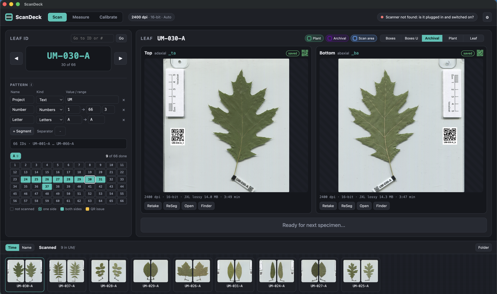
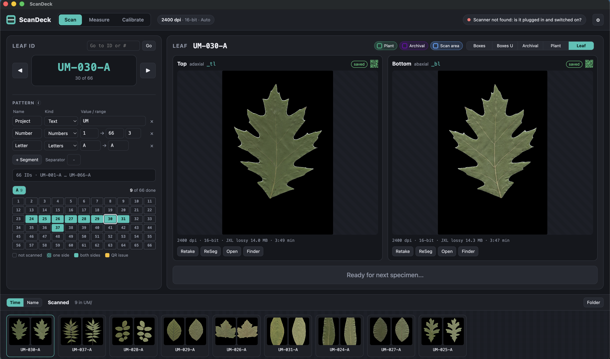
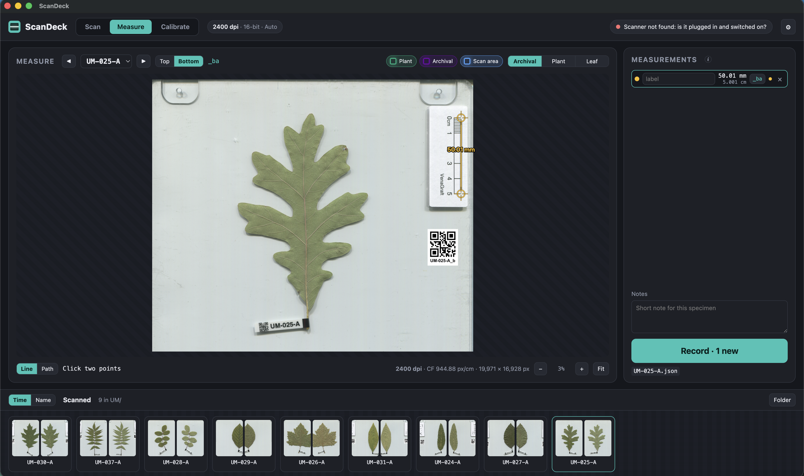
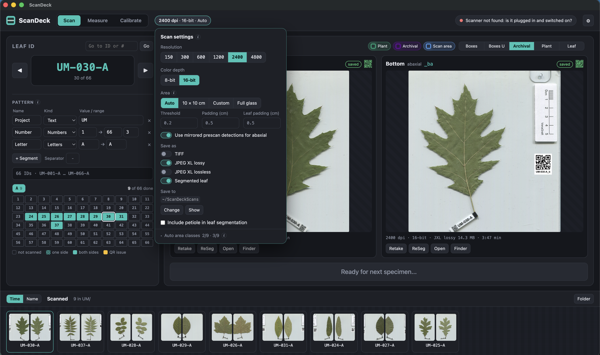

# ScanDeck

A desktop app for scanning both sides of a leaf on an **Epson Perfection V370** (macOS). Scan the
top, flip the leaf, scan the bottom, move on to the next ID. ScanDeck finds the leaf and its labels
on a quick prescan, scans only that area at full resolution, and saves an archival image, a plant
crop and a segmented leaf for each side.

No Epson Scan 2: ScanDeck drives the scanner through macOS's own scanning system (ImageCaptureCore)
with every Epson correction off, so each scan uses the same fixed settings.

## Features

- **Leaf IDs from a pattern** (for example `UM-001-A` … `UM-066-C`), a progress grid of which leaves
  have one or both sides done, and a strip of everything scanned.
- **Auto scan area.** A 75 dpi prescan of the whole glass goes through two detectors (plant
  material; rulers, labels and barcodes). A popup shows every detection with a confidence slider and
  the resulting scan area, then **Go** scans just that area. The bottom side can reuse the top's area,
  mirrored, with no second prescan.
- **Three products per side**, all from the scanned pixels:
  `_ta` archival (the whole scan area), `_tp` plant crop, `_tl` leaf only (segmented, background and
  holes black, the petiole optional). **ReSeg** segments a leaf again at another confidence without
  rescanning.
- **JPEG XL** lossy by default; lossless JPEG XL and uncompressed TIFF are options, checked
  pixel for pixel against the scan.
- **QR code check.** The QR code on the leaf's label is read and compared with the leaf ID. When it
  matches, a clean QR code for `<ID>_t` / `<ID>_b` is added to the archival image below the ruler.
- **Measure** lengths on any product, saved per specimen with the pixels-per-cm factor.
- **Calibrate** tab for timing and file-size runs across resolutions and bit depths.

## Screenshots


*The Scan tab with both sides of UM-030-A saved: the archival images (`_ta`, `_ba`) carry a clean QR code below the ruler, the green marks show each label's QR code matched the leaf ID, and the grid on the left shows which leaves have both sides done.*


*The same leaf in the Leaf view: the segmented products (`_tl`, `_bl`), leaf only on black, which the Scanned strip below shows for every leaf.*


*The Measure tab on the bottom side of UM-025-A, where a line across the ruler's 0–5 cm marks reads 50.01 mm at 944.88 px/cm (2400 dpi).*


*Scan settings: resolution and bit depth, the Auto area's detection threshold and paddings, the formats to save, and whether the leaf segmentation keeps the petiole.*

## Requirements

- macOS (developed on macOS 26, Apple silicon) and an Epson Perfection V370 on USB.
- Epson's ICA scanner driver (below).
- [Node.js](https://nodejs.org/) 22 or newer, and Xcode's command line tools (`xcode-select --install`).
- [Homebrew](https://brew.sh/) packages: `brew install openvino jpeg-xl imagemagick`

### Scanner driver

ScanDeck needs one piece of Epson software: the **ICA Scanner Driver v5.8.23** for the Perfection V370.

- **Where to get it:** Epson's V370 support page,
  <https://epson.com/Support/Scanners/Perfection-Series/Epson-Perfection-V370/s/SPT_B11B207221>.
  The installer file is `ESICA_5.8.23.dmg`
  (direct link: <https://ftp.epson.com/drivers/ESICA_5.8.23.dmg>).
- **What it does:** it lets macOS's built-in scanning system see the V370, which is how ScanDeck
  drives it. Without it the scanner shows up on USB but no app can use it.
- **Not needed:** Epson Scan 2 or any other Epson software.

## Install

```sh
git clone https://github.com/Gene-Weaver/ScanDeck.git
cd ScanDeck
npm install
npm run probe:build     # the scanner helper and the QR code reader (Swift)
npm run ov:build        # the detector and segmenter helpers (C, Homebrew's OpenVINO)
npm start
```

On first start ScanDeck downloads its models from Hugging Face (about 270 MB, once); a pill at the
top shows the progress. `npm run models:fetch` does the same from the command line.

`npm run start:mock` runs without a scanner (gradient test scans in a separate `_mock` folder).
`zsh launcher/make_launcher.sh` builds a small `ScanDeck.app` in `/Applications` that starts it.

## Output

Scans go to `~/ScanDeckScans` (changeable in Scan settings), one folder per project:

```
ScanDeckScans/UM/
  scans/      UM-001-A_ta_lossy.jxl  UM-001-A_tp_lossy.jxl  UM-001-A_tl_lossy.jxl
              UM-001-A_t.json        (the same for _b)       UM-001-A.json (measurements)
  previews/   thumbnails and the prescan with its boxes
  retakes/    earlier takes, never deleted
```

Each side's JSON sidecar records the scan settings, what the driver accepted, the prescan
detections, the crops, the QR code result and a sha256 of every file.

## Models

From [LeafMachine3](https://huggingface.co/phyloforfun), OpenVINO format, pinned to a revision and
checked by sha256 (`src/models/models.json`):

| Model | Hugging Face |
|---|---|
| Plant detector (YOLO26n) | [phyloforfun/lm3_plant_detector__yolo26n_det_640](https://huggingface.co/phyloforfun/lm3_plant_detector__yolo26n_det_640) |
| Archival detector (YOLO26n) | [phyloforfun/lm3_archival_detector__yolo26n_det_640](https://huggingface.co/phyloforfun/lm3_archival_detector__yolo26n_det_640) |
| Leaf segmenter (YOLO26x-seg) | [phyloforfun/lm3_leaf_segmenter__yolo26x_seg_1024](https://huggingface.co/phyloforfun/lm3_leaf_segmenter__yolo26x_seg_1024) |

## Development

```sh
npm test
```

Tests that need ImageMagick, JPEG XL, the built helpers or the models skip themselves when those
are missing.

| Path | What |
|---|---|
| `src/main/` | Electron main process: scanning, detection, saving, products, QR codes, models |
| `src/renderer/` | The interface (plain ES modules, no build step) |
| `probe/` | Helpers the app runs: `icprobe.swift` (scanner), `qrtool.swift` (QR codes), `ovdetect.c`, `ovseg.c` (OpenVINO) |
| `validation/` | Calibration runs started from the Calibrate tab |
| `tests/` | `node --test` suite |

## License

MIT for the code (see `LICENSE`). The model weights are not part of this repository; they are
AGPL-3.0 (Ultralytics) as published on Hugging Face.
